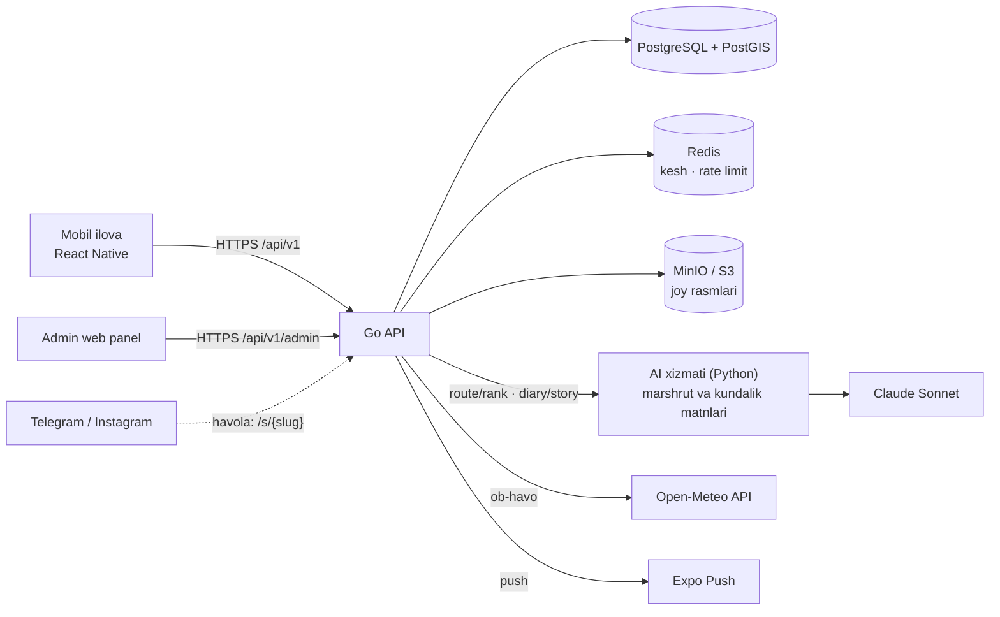
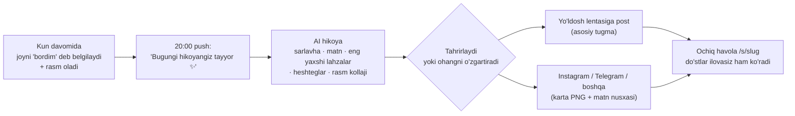

# Yo'ldosh AI — Backend qurish rejasi (v1)

Bu hujjat **hozir quriladigan** backendning rejasi. Batafsil texnik qoidalar (stack, SQL, invariantlar kodi) [BACKEND.md](BACKEND.md) da bor — bu yerda faqat qamrov, tartib va har bosqichning "tayyor" mezoni.

---

## 0. Holat (2026-11-25)

| Bosqich | Holat |
|---|---|
| 0 · Muhit va skelet | ✅ tayyor — Go 1.26 `~/.local/go` da; Docker siz lokal PostgreSQL (`make db-start`, port 5433) |
| 1 · Baza va seed | ✅ tayyor — demo ma'lumot: Samarqand 17, Buxoro 16 joy (≈50% yangi/kam tanilgan). **Haqiqiy ma'lumot keyin** |
| 2 · Sessiya, katalog, qoidalar | ✅ tayyor |
| 3 · Marshrut (asosiy) | ✅ tayyor — 500 tasodifiy profil testida invariantlar 100% |
| 5 · Admin API | ✅ tayyor — login, moderatsiya, joy CRUD (3 til), rasm yuklash, publish/reject, qoidalar, audit, KPI. **"Yangi joy chop etildi → marshrutda chiqdi" testi o'tadi** |
| 4 · Moslashuvchan marshrut | ✅ tayyor — kechikdim / charchadim / ob-havo (Open-Meteo) / bo'sh vaqt, to'xtash holati (bordim) |
| 6 – 10 | ⏳ navbatda |

Kod: [backend/](backend/) · ishga tushirish: [backend/README.md](backend/README.md).
Rejadan ataylab chetga chiqishlar (PostGIS o'rniga `earthdistance`, Redis o'rniga xotiradagi limit va h.k.) README da yozilgan.

---

## 1. Qamrov: nima hozir, nima keyin

| Holat | Modul | Izoh |
|---|---|---|
| ✅ **Hozir** | **Kashf — AI marshrut** | asosiy funksiya: shaxsiy marshrut + yangilik kvotasi |
| ✅ **Hozir** | **Qoida — geofencing** | joy qoidalari, qurilmaga geofence ro'yxati |
| ✅ **Hozir** | **Admin panel (API)** | joy qo'shish, moderatsiya, publish, qoidalar, KPI |
| ✅ **Hozir** | **Transport va to'lov** | to'xtashlar orasidagi yo'l (piyoda/taksi + narx), "karta / naqd" belgisi, bankomat va valyuta ayirboshlash |
| ✅ **Hozir** | **SOS** | favqulodda raqamlar, eng yaqin shifoxona / dorixona / politsiya |
| ✅ **Hozir** | **Sayohat kundaligi + lenta** | AI kun hikoyasini yozadi → turist uni ilova lentasiga post qiladi yoki Instagram/Telegram ga ulashadi (9-bo'lim) |
| ⏸ Keyinroq | Raqamli gid (Lens, audio, chat) | AI xizmatining vision/RAG qismi bilan birga |
| ⏸ Keyinroq | Adolatli narx | narx bazasi, verdict |
| ⏸ Keyinroq | Tadbirlar | `Stop.kind = "event"` ham shu bilan qaytadi |
| ⏸ Keyinroq | Turar joy | stays, bron |
| ❌ Olib tashlandi | Jonli tarjimon, ball va nishonlar, Telegram bot, Mahalliy hamroh | — |

Mobil ilova: **React Native** (Expo). Backend mobil ilovaga faqat HTTP API beradi, shuning uchun mijoz texnologiyasi backendga ta'sir qilmaydi.

---

## 2. Arxitektura (v1)



Asosiy qaror: **marshrutni Go o'zi tuzadi** (ball, tartib, vaqt, kvota). AI xizmati v1 da faqat matn yozadi — har to'xtash uchun `reason` ("Hunarmandchilikka qiziqishingiz uchun"), kun sarlavhasi, `summary` va **kundalik hikoyasi**, foydalanuvchi tilida. AI ishlamasa, shablon matnlar qo'yiladi va marshrut baribir chiqadi. Shu sabab demo hech qachon AI ga bog'liq holda yiqilmaydi.

v1 da **kerak emas**: pgvector (qiziqish teg bo'yicha moslashtiriladi), RAG, vision, TTS. Ular Raqamli gid bilan keladi.

---

## 3. Kerakli narsalar

### Kompyuterda (hozir yo'q)
| Nima | Holat | Nega |
|---|---|---|
| Go 1.26 | ❌ o'rnatilmagan | API |
| Docker + Docker Compose | ❌ o'rnatilmagan | Postgres, Redis, MinIO ni bitta buyruq bilan ko'tarish |
| Python 3.12+ | ✅ 3.14 bor | AI xizmati |
| psql | ✅ bor | qo'lda tekshirish |
| Go vositalari | o'rnatiladi | `goose`, `sqlc`, `oapi-codegen`, `golangci-lint` |

### Sizdan kerak
1. **Seed ma'lumot (eng muhimi):** Samarqand va Buxoro uchun har birida 15–20 joy, shundan kamida 6–8 tasi **yangi yoki kam tanilgan** (ustaxona, galereya, oilaviy oshxona). Har joyga: nom, koordinata, kategoriya, ish vaqti, 1–2 rasm, qisqa tavsif. Mashhur joylarni ochiq manbalardan o'zim to'ldira olaman; **yangi joylarni faqat siz bera olasiz** — loyihaning butun g'oyasi shunga tayanadi.
2. **Joy qoidalari** — 5–10 ta obyekt uchun (masjid, madrasa, muzey). Tasdiqlanmagani `demo` deb belgilanadi.
3. **Anthropic API kaliti** — AI xizmati uchun (7-bosqich). Usiz ham hamma narsa shablon matn bilan ishlaydi.
4. **Expo push** — mobil ilovada Expo Notifications ulanadi (kechki "hikoyangiz tayyor" eslatmasi uchun).
5. **Server va domen** — deploy bosqichida (9-bosqich). Domen ulashilgan havolalar uchun ham kerak (`yoldosh.uz/s/...`).
6. **Mobil mock ID lari** — agar React Native ilovada `mock/` fayllari bo'lsa, ID lar (`registan`, `shah-i-zinda`…) bir xil bo'lishi kerak.

---

## 4. Ma'lumotlar bazasi (v1)

[BACKEND.md §4.2](BACKEND.md) dagi DDL dan faqat quyidagilar olinadi:

| Jadval | O'zgarish |
|---|---|
| `cities`, `city_i18n` | + `taxi_base_fare`, `taxi_per_km` (taksi narxini hisoblash), + `emergency jsonb` (`{police:"102", ambulance:"103", fire:"101", unified:"112"}`) |
| `places`, `place_i18n`, `place_rules` | o'zgarishsiz (`pay_card`, `cash_only` allaqachon bor) |
| `users`, `devices` | `users.points` **olib tashlanadi** (ball yo'q); + `users.display_name`, `users.avatar_url` (lenta uchun); + `devices.push_token`, `devices.timezone` |
| `trips`, `trip_days`, `stops` | `stops.kind` faqat `place \| meal`; `event_id` ustuni keyinga; `stops.status` (`upcoming \| visited \| skipped`) — kundalik shunga tayanadi |
| `visits` | faqat baho (`rating`, `comment`) — yangi joylar reytingi uchun |
| `admin_users` | **yangi**: `id, email, password_hash (argon2id), role (moderator\|admin)` |
| `admin_audit` | **yangi**: `id, admin_id, action, entity, entity_id, before jsonb, after jsonb, at` |
| `city_services` | **yangi** (SOS + to'lov): `id, city_id, kind (hospital\|pharmacy\|police\|embassy\|atm\|exchange), name jsonb, location geography, phone, hours jsonb, open_24h bool` |

| `diary_photos` | **yangi**: `id, user_id, trip_id, day_idx, stop_id?, url, width, height, taken_at, created_at` — EXIF va GPS olib tashlangan |
| `diary_entries` | **yangi**: `id, user_id, trip_id, day_idx, lang, tone, title, body, highlights jsonb, hashtags text[], photo_ids text[], status (draft\|ready), generated_by (ai\|template), edited bool` |
| `posts` | **yangi**: `id, user_id, diary_entry_id, city_id, slug (ochiq havola), visibility (public\|link\|private), status (visible\|hidden\|removed), likes_count, views_count, created_at` |
| `post_likes` | **yangi**: `(post_id, user_id)` PK |
| `post_reports` | **yangi**: `id, post_id, user_id, reason, created_at` |
| `share_events` | **yangi**: `id, post_id?, diary_entry_id, target (feed\|instagram\|telegram\|other\|copy), created_at` — qancha odam ulashganini o'lchash |

Olinmaydi: `events`, `stays`, `price_items`, `price_observations`, `vendors`, `scam_reports`.

> Favqulodda raqamlar (101/102/103/112) seed ga kiritishdan oldin rasmiy manbadan tekshiriladi.

---

## 5. API (v1)

Shakllar [API_CONTRACT.md](API_CONTRACT.md) dagi bilan bir xil; quyida faqat ro'yxat.

| Guruh | Endpoint | Bosqich |
|---|---|---|
| Sessiya | `POST /auth/device`, `GET /me`, `PATCH /me` | 2 |
| Katalog | `GET /cities`, `GET /places` (filtr: shahar, kategoriya, novelty, qiziqish, `near`, `openNow`, `wheelchair`), `GET /places/{id}`, `GET /places/{id}/reviews` | 2 |
| Qoida | `GET /geofences?city=` | 2 |
| Marshrut | `POST /trips`, `GET /trips`, `GET /trips/{id}`, `POST /trips/{id}/stops`, `DELETE /trips/{id}/stops/{stopId}`, `POST /trips/{id}/stops/{stopId}/swap` | 3 |
| Moslashuvchan | `POST /trips/{id}/replan` (`late \| tired \| weather \| free_time`), `POST /visits` | 4 |
| Admin | `POST /admin/auth/login`, `GET /admin/places?status=`, `POST /admin/places`, `PATCH /admin/places/{id}`, `POST /admin/places/{id}/images` (presigned URL), `POST /admin/places/{id}/publish`, `POST /admin/places/{id}/reject`, `PUT /admin/places/{id}/rules`, `GET /admin/analytics/novelty` | 5 |
| SOS va to'lov | `GET /cities/{id}/emergency`, `GET /services?city=&kind=&near=` | 6 |
| Kundalik | `PATCH /trips/{id}/stops/{stopId}` (`status: visited \| skipped`), `POST /diary/photos` (presigned URL) → `POST /diary/photos/{id}/confirm`, `POST /trips/{id}/days/{idx}/diary` (hikoya yaratish, `tone`), `GET /diary/{entryId}`, `PATCH /diary/{entryId}` (matnni tahrirlash), `POST /diary/{entryId}/regenerate` | 8 |
| Ulashish | `POST /diary/{entryId}/publish` → post; `GET /diary/{entryId}/share-card?format=story\|post` (PNG); `POST /diary/{entryId}/shares` (`target`) | 8 |
| Lenta | `GET /feed?city=&cursor=`, `GET /posts/{id}`, `POST /posts/{id}/like`, `DELETE /posts/{id}/like`, `POST /posts/{id}/report`, `DELETE /posts/{id}` | 8 |
| Ochiq sahifa | `GET /s/{slug}` — HTML, OpenGraph rasmi bilan (Telegram/Instagram havola ko'rinishi), "Ilovani yuklab olish" tugmasi | 8 |
| Admin | `GET /admin/posts?status=reported`, `POST /admin/posts/{id}/hide` | 8 |
| Oflayn | `GET /cities/{id}/offline-pack` (joylar + qoidalar + geofence + SOS) | 6 |

**Kontraktga o'zgartirishlar** (API_CONTRACT.md ga kiritiladi): `Stop.kind` dan `event` vaqtincha chiqadi; `POST /visits` javobi `{ ok: true }` (ball yo'q); `/admin/auth/login`, `/services`, `/cities/{id}/emergency`, kundalik, lenta va `/s/{slug}` qo'shiladi; lens, guide, prices, events, stays endpointlari v1 da yo'q.

---

## 6. Marshrut qanday tuziladi (Go)

```
POST /trips → [1] nomzodlar (SQL) → [2] ball → [3] kunlarga bo'lish + tartib
           → [4] vaqt jadvali + transport → [5] Validate() → [6] AI matnlar (ixtiyoriy) → saqlash
```

1. **Nomzodlar:** `published`, shu shahar, qiziqishga mos, cheklovlarga mos (`wheelchair`, bolali oila), sana kuni ochiq. Uch hovuz: `iconic`, `new|hidden`, ovqat joylari.
2. **Ball:** `qiziqish mosligi × Bayes reyting × (yangi joy bo'lsa +bonus) × byudjet mosligi`. Hamkor joyga ball **qo'shilmaydi**.
3. **Kunlarga bo'lish:** kuniga `pace` bo'yicha 4 / 5 / 6 joy. Har kunga avval 1–2 ta `new|hidden` "langar", keyin eng yuqori ballilar. Tartib — boshlanish nuqtasidan eng yaqin qo'shni (greedy), keyin 2-opt bilan qisqartirish.
4. **Jadval:** 09:00 dan; tushlik 12:30–14:00 oralig'iga eng yaqin ovqat joyi. Transport: < 1.2 km → piyoda (≈ 80 m/daq, to'g'ri chiziq × 1.3), aks holda taksi va narx `taxi_base_fare + km × taxi_per_km`.
5. **Invariantlar** (BACKEND.md §5 dagi `Validate()`): har kunda kamida 1 yangi joy, umumiy ulush ≥ 25%, hamkor joy kvotaga kirmaydi, vaqtlar ustma-ust tushmaydi, `reason` bo'sh emas. Buzilsa — Go o'zi tuzatadi (eng past ballik mashhur joyni eng yaqin yangi joyga almashtiradi).
6. **AI matnlar:** AI xizmati 6 s ichida javob bersa — uning `reason`/`summary` lari; aks holda i18n shablonlar. AI faqat matn qaytaradi; joy, tartib va vaqtni o'zgartira olmaydi.

**Replan:**
- `late` / `tired` — qolgan to'xtashlardan eng past ballilari olib tashlanadi, yangi joy langari saqlanadi;
- `weather` — Open-Meteo dan shu kun ob-havosi: issiq (> 35°C) yoki yomg'irda ochiq joylar (park, viewpoint, ecovillage) yopiq joylarga (muzey, galereya, ustaxona) almashtiriladi;
- `free_time` ("bo'sh 2 soatim bor") — joriy joylashuvdan 1.5 km ichida, berilgan daqiqalarga sig'adigan qisqa marshrut.

Javobda `changes: string[]` — nima o'zgargani foydalanuvchi tilida.

**Gavjumlik** v1 da yo'q: ma'lumot manbai yo'q. Keyinroq `visits` va ilova ochilishlaridan soat bo'yicha taxmin qilinadi.

---

## 7. Bosqichlar

Har bosqich oxirida ishlaydigan, test qilingan natija bo'ladi. Men (Claude) har birini to'liq yoza olaman; ⚠️ belgili joylarda sizning qatnashuvingiz kerak.

| # | Bosqich | Natija | Tayyor mezoni |
|---|---|---|---|
| **0** | Muhit va skelet | Go va Docker o'rnatiladi ⚠️ (`sudo` kerak); `backend/` papka, `docker-compose.yml` (Postgres+PostGIS, Redis, MinIO), `Makefile`, `.env.example`, `GET /healthz`, JSON loglar, xato formati | `make up && make run` → `/healthz` 200 |
| **1** | Baza va seed | goose migratsiyalari (4-bo'lim), sqlc so'rovlari, `cmd/seed` (idempotent UPSERT), `seed/samarkand.json`, `seed/bukhara.json` | `make migrate seed` → har shaharda ≥ 15 joy, ≥ 40% yangi/kam tanilgan ⚠️ (yangi joylar ro'yxati sizdan) |
| **2** | Sessiya, katalog, qoidalar | `/auth/device`, `/me`, `/cities`, `/places`, `/places/{id}`, `/geofences`; i18n fallback (so'ralgan til → en → uz); Redis rate limit; katalog keshi + ETag | uch tilda javob; `near=` so'rovi masofa bo'yicha saralaydi; testcontainers bilan PostGIS testlari |
| **3** | **Marshrut (asosiy)** | `POST /trips` (6-bo'lim, AI siz), `GET /trips/{id}`, to'xtash qo'shish / o'chirish / almashtirish | `Validate()` table-driven testlari; 500 ta tasodifiy profil → hammasida invariantlar 100% bajariladi; ikki xil qiziqish → sezilarli farqli marshrut |
| **4** | Moslashuvchan marshrut | `/replan` (4 sabab), Open-Meteo mijozi (kesh 1 soat), `POST /visits` | har sabab uchun test; ob-havo API o'chiq bo'lsa replan baribir ishlaydi |
| **5** | Admin API | admin login (argon2id, alohida token), moderatsiya navbati, joy CRUD (3 tilda matn), rasm yuklash (presigned URL, EXIF tozalash), publish/reject, qoidalar (`rules_version + 1`), audit log, novelty KPI | **jonli demo:** adminda yangi joy publish qilinadi → keyingi `POST /trips` da shu joy chiqadi |
| **6** | SOS, to'lov, oflayn | `city_services` seed ⚠️ (shifoxona, dorixona, bankomat manzillari), `/cities/{id}/emergency`, `/services`, `/offline-pack` (gzip, ETag → 304) | oflayn paket < 1 MB (rasmlarsiz); `near=` bilan eng yaqin dorixona |
| **7** | AI xizmati | Python FastAPI: `/internal/health`, `/internal/route/rank` (Claude Sonnet, faqat matn), `/internal/diary/story` (9-bo'lim); Go mijozi: timeout 6 s, 1 marta retry, circuit breaker ⚠️ (API kalit) | AI o'chiq / sekin / buzuq JSON → marshrut baribir 201; `reason` lar foydalanuvchi tilida |
| **8** | **Sayohat kundaligi + lenta** | stop holati, rasm yuklash, hikoya yaratish (AI + shablon), tahrirlash, ulashish kartasi (PNG), post, lenta, like, shikoyat, `/s/{slug}` ochiq sahifa, kechki push eslatma, admin post moderatsiyasi | kun yakunida 2+ joyga borilgan bo'lsa 20:00 da push keladi; hikoya ≤ 10 s da tayyor; AI o'chiq bo'lsa shablon hikoya; Telegram ga havola tashlanganda rasm va sarlavha ko'rinadi; 3 ta shikoyat → post avtomatik yashiriladi |
| **9** | Deploy | Dockerfile (Go statik binar), production compose, Caddy (HTTPS), zaxira nusxa (`pg_dump` cron), `.env` serverda ⚠️ (server, domen) | `https://<domen>/api/v1/healthz` ishlaydi; mobil ilova `EXPO_PUBLIC_API_URL` bilan ulanadi |
| 10 | Admin web UI (ixtiyoriy) | React + Vite: login, joylar ro'yxati, joy formasi (xarita bilan koordinata tanlash), qoidalar, KPI | moderator brauzerdan joy qo'shib publish qila oladi |

**Ustuvorlik:** vaqt qisilsa 4, 6, 10 qisqartiriladi. **0–3 va 5 — majburiy:** ular loyihaning asosiy g'oyasini ko'rsatadi ("yangi joy qo'shildi → marshrutda chiqdi"). **8** — o'sish dvigateli: har ulashilgan hikoya yangi joylar va ilova uchun bepul reklama.

---

## 8. Papka tuzilmasi

```
backend/
├── cmd/api/main.go · cmd/seed/main.go
├── api/openapi.yaml               # API_CONTRACT.md ning v1 qismi
├── internal/
│   ├── http/                      # router, middleware (auth, lang, ratelimit, recover), handlerlar
│   ├── domain/                    # Place, Trip, Stop, Rule + Validate() — bog'liqliksiz
│   ├── store/                     # sqlc chiqishi
│   ├── catalog/                   # cities, places, geofences
│   ├── trip/                      # nomzod, ball, rejalashtirgich, jadval, replan
│   ├── geo/                       # masofa, transport, offline-pack, services
│   ├── weather/                   # Open-Meteo mijozi
│   ├── ai/                        # AI xizmati mijozi (timeout, breaker)
│   ├── admin/                     # login, moderatsiya, audit
│   ├── diary/                     # rasm, hikoya, share-card, push eslatma
│   ├── feed/                      # post, lenta, like, shikoyat, /s/{slug}
│   ├── auth/ · i18n/ · platform/
├── db/migrations/ · db/queries/
├── seed/
└── docker-compose.yml · Makefile · Dockerfile · .env.example
ai/                                # Python AI xizmati (7-bosqich)
├── app/main.py · app/route_text.py · app/diary_story.py · app/prompts/
└── pyproject.toml · Dockerfile
```

---

## 9. Sayohat kundaligi va lenta

**G'oya:** kun oxirida Yo'ldosh turistning bugungi sayohatidan chiroyli, iliq hikoya yozib beradi va uni **post qilishga undaydi**. Birinchi taklif — **Yo'ldosh lentasiga** joylash (boshqa turistlar ko'radi, yangi joylar haqida bilib oladi). Xohlamasa — **Instagram, Telegram** yoki boshqa joyga bir bosishda ulashadi. Ikkalasi ham bizga foyda: lenta ilovani jonli qiladi, tashqi ulashish yangi foydalanuvchi olib keladi.

### Foydalanuvchi oqimi



### Hikoya qanday yoziladi

1. **Faktlar yig'iladi (Go):** shu kun `visited` to'xtashlar tartibi, vaqtlari, joy nomlari, har joydan 1 ta tasdiqlangan fakt (`place_i18n.history_facts`), yangi joylar belgisi, yurgan masofa, turistning rasmlari soni, ixtiyoriy qisqa izohi.
2. **AI (`POST /internal/diary/story`, Claude Sonnet):** shu faktlardan foydalanuvchi tilida hikoya yozadi. Qaytaradi: `title` (≤ 60 belgi), `body` (600–900 belgi, birinchi shaxsda, iliq ohang), `highlights` (3 ta qisqa qator), `hashtags` (≤ 5, masalan `#Buxoro #Yo'ldoshAI`), `caption` (Instagram uchun qisqa variant ≤ 300 belgi).
3. **Ohang tanlovi (`tone`):** `warm` (iliq, standart) · `short` (qisqa) · `fun` (quvnoq) · `poetic` (she'riy).
4. **Qat'iy qoidalar (prompt + Go tekshiruvi):** faqat berilgan joylar va faktlar ishlatiladi — AI boshqa joy, sana yoki tarixiy fakt **to'qimaydi**; javobdagi har joy nomi faktlar ro'yxatida borligi Go da tekshiriladi, bo'lmasa qayta yoziladi yoki shablon ishlatiladi; reklama ohangi yo'q; yangi/kam tanilgan joy hikoyada albatta tilga olinadi ("hali kam odam biladigan…").
5. **Fallback:** AI ishlamasa — tayyor shablon: "Bugun {shahar}da {n} ta joyni ko'rdim: {joy1}, {joy2}… Eng yoqqani — {yangi joy}."
6. Turist matnni erkin tahrirlaydi (`edited = true`); qayta yaratish kuniga 5 marta (rate limit).

### Ulashish kartasi (PNG)

- Go server tomonda chizadi: 1–4 rasm kolaji, sarlavha, 3 ta lahza, shahar va sana, kichik "Yo'ldosh AI" belgisi va havola.
- Ikki o'lcham: `story` 1080×1920 (Instagram/Telegram story), `post` 1080×1350.
- Lotin va kirill yozuvi uchun shrift (Inter / Noto Sans) binar ichiga joylanadi.
- Natija S3 da keshlanadi; matn o'zgarsa qayta chiziladi.

### Lenta (ilova ichida)

- `GET /feed?city=` — eng yangi postlar, shu shahar bo'yicha filtr; har postda kartochka, sarlavha, muallif ismi, like soni, **tilga olingan joylar** (bosilsa joy sahifasi → "marshrutimga qo'shish"). Shunday qilib lenta marshrut tuzishga ham xizmat qiladi.
- `visibility`: `public` (lentada), `link` (faqat havola orqali), `private` (faqat o'zi).
- Like, shikoyat; o'z postini o'chirish.

### Undash (nudge) mexanizmi

| Qachon | Nima |
|---|---|
| Kun davomida | joyga kelganda (geofence) "Rasmga oling — kechqurun hikoyangizga qo'shamiz" |
| 20:00 (turist vaqt zonasi) | push: "Bugungi hikoyangiz tayyor ✨" — faqat kamida 2 ta joyga borilgan bo'lsa; kuniga 1 tadan ko'p emas |
| Hikoya ochilganda | asosiy tugma **"Yo'ldoshda ulashish"**, ikkinchi qatorda Instagram / Telegram / Nusxa olish |
| Post qilingandan keyin | "Hikoyangizni N kishi ko'rdi" — keyingi kun yana yozishga rag'bat |
| Sayohat oxirida | barcha kunlarni bitta "Sayohat albomi"ga birlashtirish taklifi (keyingi versiya) |

### Maxfiylik va xavfsizlik

- Rasmlardan EXIF/GPS olib tashlanadi; postda aniq vaqt va koordinata ko'rsatilmaydi, faqat shahar va sana.
- Post faqat foydalanuvchi o'zi bosganda chiqadi — avtomatik post yo'q.
- Muallif sifatida faqat `display_name` (taxallus) ko'rinadi.
- Shikoyat: 3 ta turli foydalanuvchi shikoyati → post avtomatik yashiriladi va admin navbatiga tushadi.
- Rasm va matn uchun oddiy filtr (nomaqbul so'zlar ro'yxati; rasm moderatsiyasi keyingi versiyada).

### O'lchanadigan ko'rsatkichlar

| Ko'rsatkich | Qanday |
|---|---|
| Hikoya yaratilgan kunlar ulushi | `diary_entries` / faol trip kunlari |
| Ulashish darajasi | `share_events` / `diary_entries` (lenta va tashqi alohida) |
| Havoladan kelganlar | `/s/{slug}` ko'rishlar → ilova o'rnatish |
| Lentadan marshrutga qo'shilgan joylar | postdagi joydan `POST /trips/{id}/stops` |

## 10. Testlar

- **Domain:** `Validate()` chegaralari (ulush 0.24 / 0.25, faqat hamkor yangi joy, ustma-ust vaqt, bo'sh `reason`).
- **Rejalashtirgich:** tasodifiy profillar × seed → doim yaroqli `Trip`; AI fake: yaxshi javob, timeout, buzuq JSON.
- **Store:** testcontainers (haqiqiy PostGIS) — `ST_DWithin`, i18n fallback tartibi.
- **HTTP:** javoblar `openapi.yaml` ga validatsiya qilinadi; uch til; xato formati.
- **Kundalik:** AI javobida faktlarda yo'q joy nomi bo'lsa rad etiladi; shablon fallback; push faqat 2+ tashrifda va kuniga 1 marta; 3 shikoyat → yashirish.
- **CI:** `golangci-lint` + `go test -race` + `sqlc diff`.

---

## 11. Ochiq savollar

1. Yangi / kam tanilgan joylar ro'yxatini kim va qachon beradi? (1-bosqichni to'xtatib turadi)
2. Admin panel UI kerakmi, yoki boshida faqat API + seed yetadimi?
3. Lenta faqat shahar bo'yicha bo'lsinmi, yoki obuna (follow) ham kerakmi? v1 da obunasiz taklif qilinadi.
4. Server qayerda (VPS, bulut)? Domen bormi?
