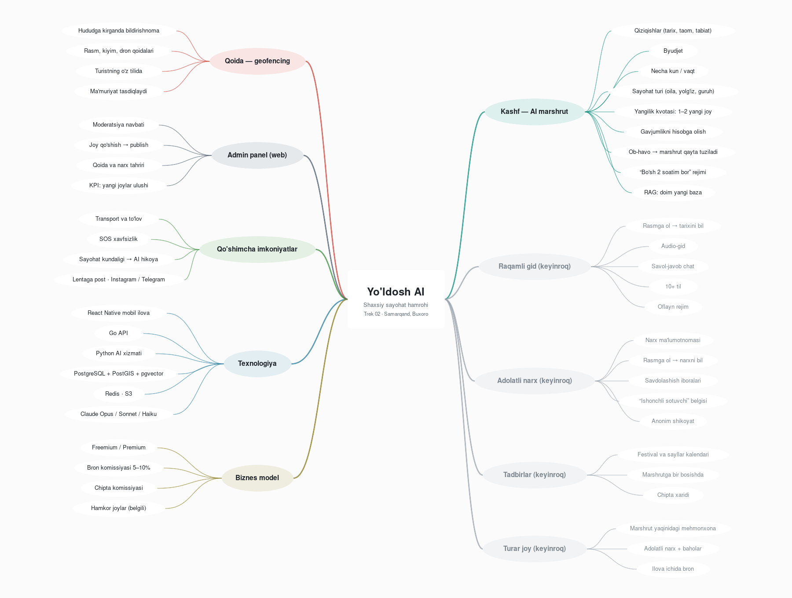
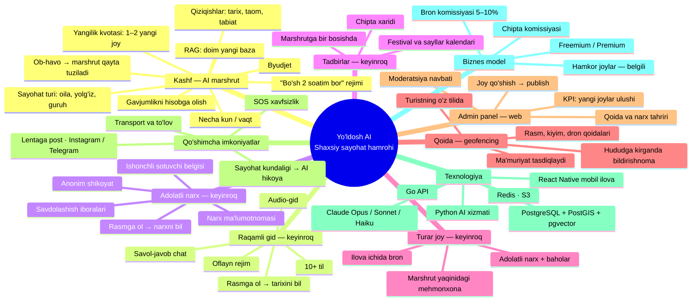
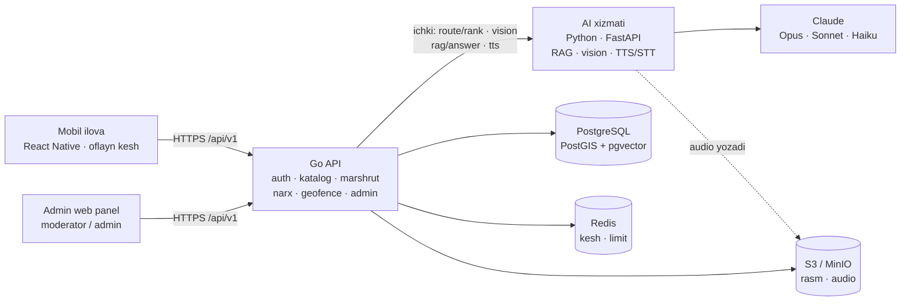
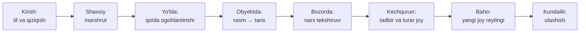

# Yo'ldosh AI — loyiha xaritasi

> Kulrang punktir — keyingi bosqichga qoldirilgan modullar.

## 1. Mind-map (Mermaid)

## 2. Tizim qanday ishlaydi

Mijozlar AI xizmatini to'g'ridan-to'g'ri ko'rmaydi: hamma so'rov Go API orqali o'tadi. AI ishlamay qolsa, Go ichidagi oddiy rejalashtirgich marshrutni baribir tuzadi, ilova esa `503 ai_unavailable` olib, keshdagi ma'lumotni ko'rsatadi.

## 3. Turistning bir kuni

